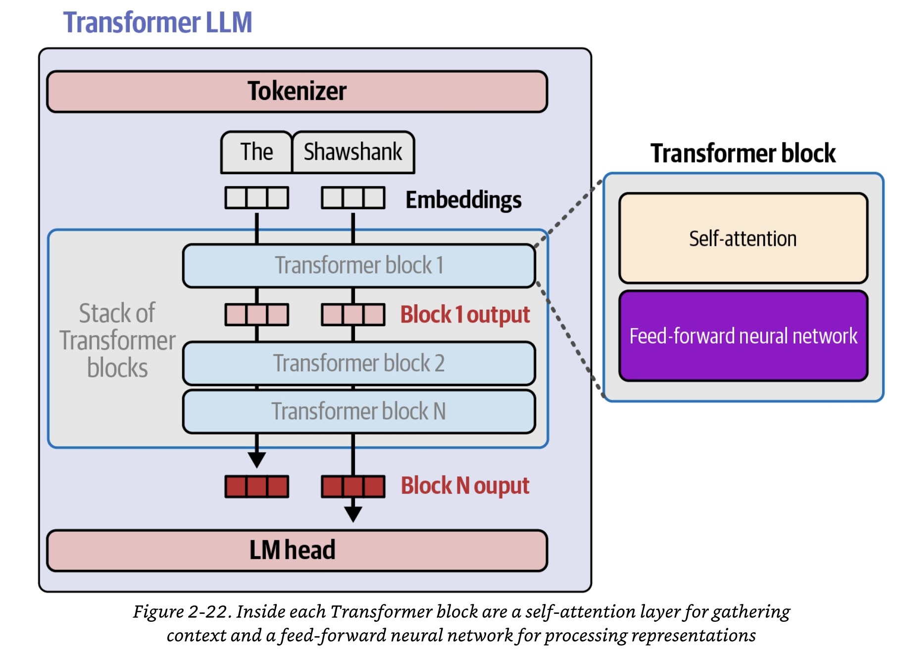
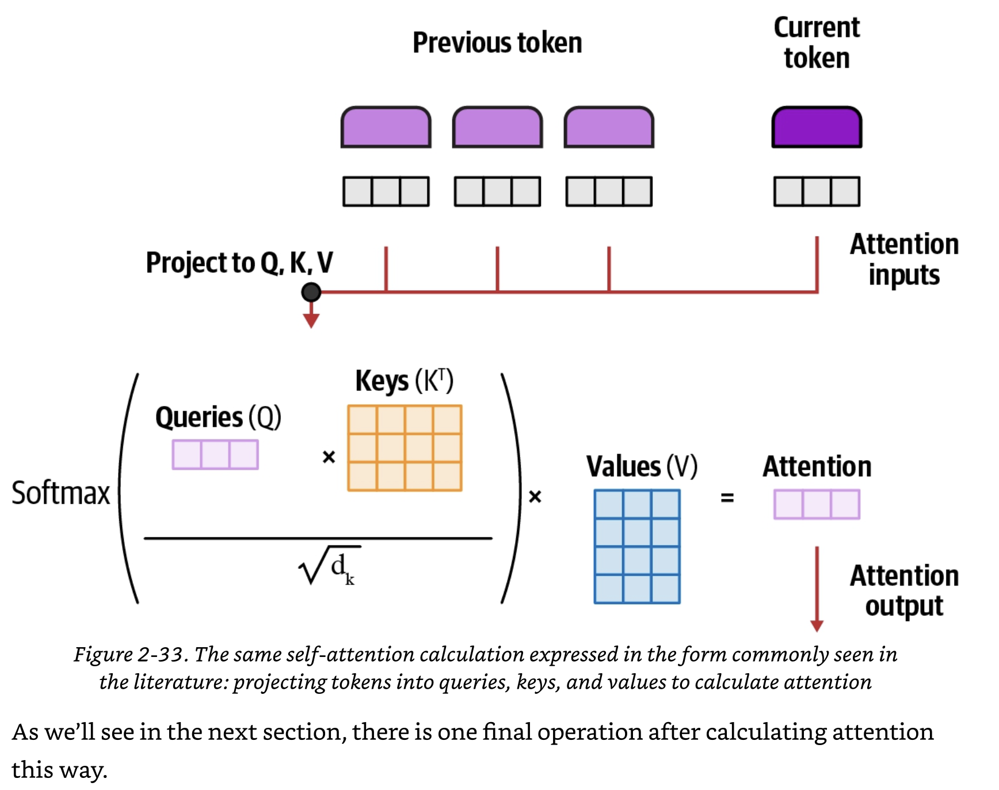
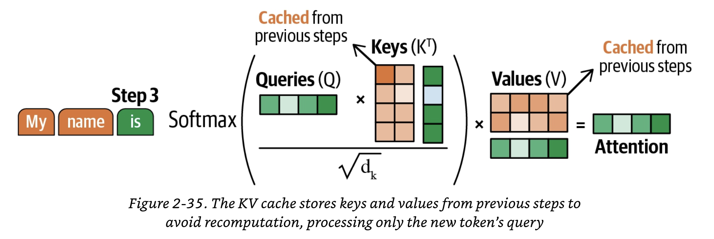
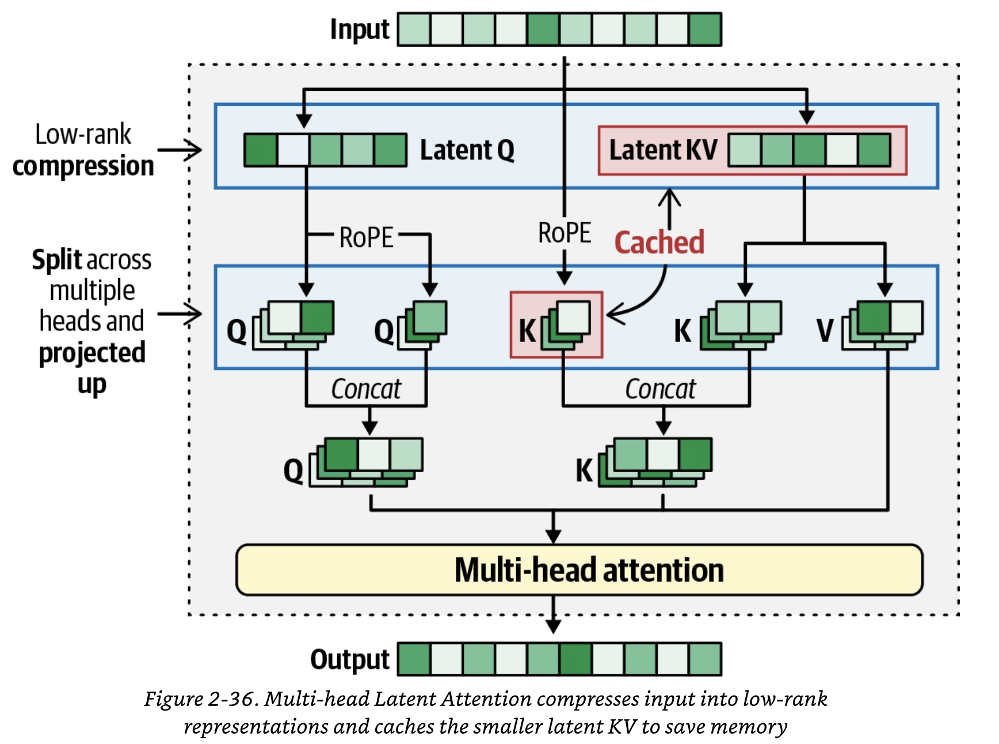
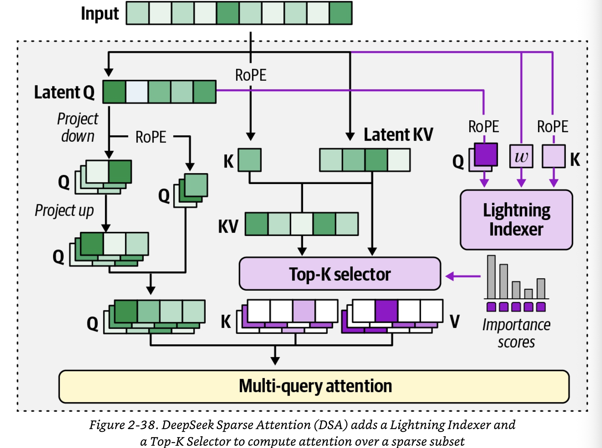
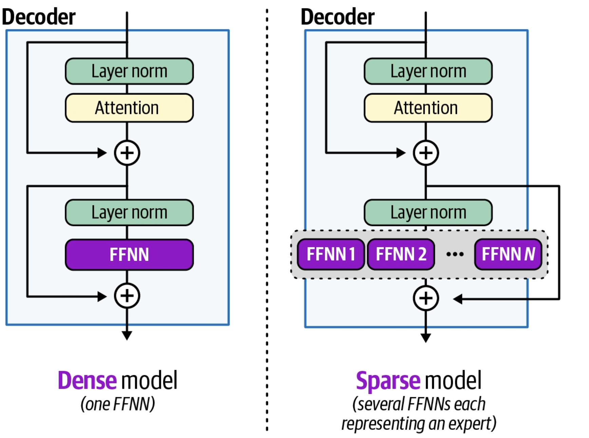
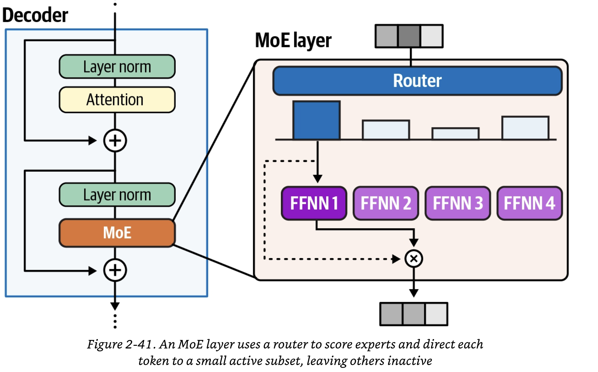

**System prompts** The party that deploys the model needs a way to describe the expected behavior of the model in
a way that takes precedence over the end user ask of the model.
--> priviledged input that shapes the model behavior before the model sees a single token from the user.

A vital component of an agent harness is to enable easy debugging of what is happening.

To do so, we keep track of each Step the agent has taken. To reach its final answer, an agent might need various steps and use
different actions. The sequence of steps is called **agent's trajectory**.

# Training a LLM

LLMs go through 2 major phases of training: **pre- and post-training**.

##  Pre-training: language modeling

**Language modellling** is the task of presenting a model with a sequence of words (or tokens) and
asking it to predict the next word that is most likely to appear.

Pre-training ends up to produce a **base model**.

## Post-training: supervised fine-tuning

Base models have strong latent capabilities (reasoning, summarization, and code generation) that often require heavy
prompt engineering to unlock.

Post-training helps polish these model behaviors.

The first step of post-taining is called **supervised fine-tuning (SFT)**. 
The update rule is almost the same as for pre-training. The key difference is that while prompt tokens are
included in the input context, they are excluded from the loss computation so that the model is trained only on the
response token.

## Post-training: reinforcement learning

Evaluate the quality of a model-generated response and update the model's weights based on that quality score, called
a **reward**.

One of the commonest used RL method is **Reinforcement learning from Human Feedback (RLHF)**.

The RLHF objective is to update the model to increase the likehood of generating output like the preferred response
and decrease the likehood of generating output like the rejected response.

The other major RL method is **Reinforcement Learning with Verifiable Rewards** (RLVR). The difference with RLHF is that
the rewards can be obtained from automated ways of verifying the output. 

The **Group relative Policy Optimization (GPRO)** algorithm has another key ingredient beyond reward assignment. Rather than scoring a single response, at each training step GPRO generates a group of responses for the same prompt using a temperature setting that ensures diversity among them. Rewards are then computed relative to this group, reinforcing responses that score higher than others.

# The transformer architecture

## Tokenizer, Transformer blocks and language modelling head

The **tokenizer** breaks the text input into tokens.

A tokenizer has a set of tokens in its vocabulary and an equal number of vector embeddings, one per token.
These embeddings are numeric representations of each token and they are what the model uses to calculate language and
how it processes its inputs.

Almost the entirety of the processing inside a language model is conducted inside the stack of **transformer blocks**.

What results is a single vector containing information on what the next tocken should be. The vector is passed to the
**LM head** to interpret. It makes a simple calculation, which results in a probability score for each token in its vocabulary. 

The medthod to pick tokens from the probability distribution is called **decoding strategy**.

**Temperature setting** of an LLM is playing with these probabilities. Increasing the temperature allows **sampling**,
which means choosing from the distribution in a way where lower probability tokens see their chance to be picked increased.

## Processing through the Transformer blocks

A neural network processes inputs and produces an output in a **forward pass**. This means that the calculation
flows sequentially throught the various layers.

The number of tracks that a model supports is commonly known as its **context size**. So a model with a context length
of 100,000 can only have that number of tokens flowing through it simutaneously. 

For text generation, the processing flow of the last token is what's used to generate the next token. That calculation is
informed, however, by all the processing conducted on the previous tokens.

For agent developers, context length is a key property. It sets a limit on how much information we can pack in the input of the model. 

Another key concept for agent developers is that it is common to cache the results after the first pass so that in the next forward pass we process information along only the one track associated with the new token we are generating. This is referred to as **prompt caching**, **prefix-caching** or **kv caching**.

## Inside the Transformer block

There are 2 major components inside a Transformer block: a self-attention layer and a feed-forward neural network layer.

### The Transformer block: the feed-forward neural network

This layer does the heavy lifting in predicting the next token beacuse the training process shapes its ability to predict the patterns encoded in the training dataset.

The feed-forward layers store factual associations learned during training. It is one big neural network. 
In recent years, there has been a trend away from having a single large network, and replacing it with a large 
number of smaller, more specialized networks. This architecture is called a **mixture-of experts (MoE)**.

### The Transformer block: an overview of self-attention

Self-attention attends to the most relevant previous tokens in the sequence. It learns that relevance from the training process. It enriches the information encoded in the input vector with information from the most relevant previous tokens in the sequence. it does this by taking two steps:
1. it scores the relevance of the previous tokens
2. it proceeds to a step of combining the relevant information into the token we are processing

# Deeper dive into Large Language Models

## How self-attention works

Going into the attention calculation are a collection of vectors: the vector for the current positions and the vectors for the previous positions.
The input vectors are multiplied by 3 projection matrices: 
1. query projection matrix
2. key projection matrix
3. value projection matrix

The results are matrices called queries, keys and values matrices.

The first step of self-attention involves multiplying the query for the token currently being processed by the key vectors associated with all the input tokens. This results in a relevance score for each vector.

After deciding the relevance values, self-attention then proceeds to combine information from these tokens, weighted by how relevant they are, and merge them into the vector of the current token.

This vector is the output of the attention layer. 

## KV-caching revisited

The attention vectors can be cached in the KV to avoid recalculating them in all the steps.
Note that the query vector Q does not need to be cached because they become unnecessary in subsequent iterations. We need the query vector of the latest token to compute self-attention.

 

## More efficient self-attention

### Multi-head Latent Attention (MLA)

A major step in making the KV-cache memory efficient is through MLA, first used in DeepSeek-V2 and popularized in
DeepSeek-R1. 
MLA is a variant of Multi-head Attention, which maintains separate Q, K and V projection matrices for each attention head, producing different Q, K and V matrices per head. MLA uses low-rank joint compression of the keys and values to
reduce the KV cache during inference. At its core, it compresses the keys and values into a smaller latent representation that is cached in place of the full K and V. 

MLA first compresses the input embeddings into lower-dimansional representations called the latent Q and latent KV. These representations are significantly smaller than the full Q and KV. Positional information via Rotary Position Embedding (RoPE) is appled to a decoupled component of the latent Q, since latent Q is recomputed at every step. RoPE is not applied to latent K, because the cached K would then need to be recomputed at every step, breaking the benefit of caching.

### DeepSeek Sparse Attention

The next step in making MLA more efficient was first introduced in DeepSeek-V3.2.
This new attention mechanism, **DeepSeek Sparse Attention (DSA)** is instantiated under MLA and is an additional
module to more efficiently select the tokens to attend to. It has two components:
1. The **lightning indexer** determines how relevant each preceding token is to the current query. For that, it
uses the Q/K values that both have RoPE (Rotary Position Embedding) applied to them. Likewise it takes in a scalar weight
paramter w that helps the lightning indexer to make better decisions about which tokens to select for the full attention
mechanism.
2. A **Top-K selector**. The output of the lightning indexer is scores fed to the Top-K selector, which in turn retrieves only
the KV entries that correspond to the the Top-K index scores. 

### Mixture of experts (MoE)

MoE uses several submodels or "experts" to improve the quality and efficiency of LLMs. There are 2 main components of an MoE:

**Experts**
Each feed-forward neural network in an LLM is replaced by a set of "experts".

**Router or gate network**
Determines which tokens are sent to which experts.

A typical Transformer-based LLM uses self-attention followed by a feed-forward neural network (FFNN). This is called a 
**dense model** because everything is activated.

A **sparse model**, in contrast, may deploy several feed-forward neural networks instead. These are typically smaller than regular network, but together they tend to be bigger.

Each FFNN in a sparse model is typically referred to as an "expert" because, during training; each "expert" learns different information and may specialize in the processing of certain tokens. These experts actually specialize in 
fine-grained information such as verbs versus numbers rather than learning each a different domain.

To choose a subsert oof experts during inference, we make use of the router (gate network). This is a small feed-forward
neural network trained to choose an expert for a given token. The router with the experts make up the MoE layer.

The router is the most important component because the experts are nothing more than just small FNNNs. 

The router, as a neural network, will have its own weight matrix, which is used to multiply the input token embeddings.
Applying a softmax on the output will result in a probability distribution per expert. 

Any number of experts can be selected, but generally a fixed number are selected for training and inference. When selecting multiple experts, there is a need to balance how much each expert is trained. If the same set of experts is always selected during training and inference, all the other experts are undertrained.

To prevent one expert from dominating the training time, there are two main techniques:
**Expert capacity** gives each expert in the MoE layer a limit to how many tokens it can process. 
**Auxiliary loss** are loss functions that can be added to the router to reward it for equally distributing the experts during the training or punish it when the same expert is chosen.

