# Reasoning large Language Models

Reasoning in LLMs attempts to mimic human thinking by generating thoghts through tokens before giving a final answer.
Reasoning is critical in AI agents because it allows them to plan out behavior, decide which actions to take, and reflect on the actions they have have taken. 

## The paradigm shift from Train-Time Compute to Test-Time Compute

### Train-Time Compute versus Test-time Compute

To improve the performance of LLMs during pre-training, developers used to focus on three main factors:
1. Increasing the model size (number of parameters)
2. Increasing the dataset size (number of tokens)
3. Increasing compute (number of floating-point operations per seconds [FLOPS])

This combination of factors is called Train-Time Compute.

In contrast, test-time compute focuses more on scaling inference instead of pre-training and post-training.
Scaling inference generally applies to reasoning LLMs and allows them to "think longer" during inference.

The underlying idea is that the more tokens you generate, the better the resulting performance will be. 

To sum up, train-time compute focuses on scaling resources (e.g. data and compute) spent during pre-training and post-training, while test-time compute focuses on scaling resources (e.g. compute) spent during inference.

### Scaling Laws

Jared Kaplan found that a model's performance improves predictably as you increase compute, dataset size, and parameters, but with diminishing returns.
Findings also showed that models we often undertrained and that for a fixed compute budget, it's better to use a smaller model and train it on much more data.

A post by OpenAi detailed that increasing test-time compute might affect performance the same as increasing train-time compute. They defined the train-time compute as more reinforcement learning (RL), and the test-time compute as more time spent thinking.

Research in scaling laws for test-time compute all point to the significant benefit of scaling test-time compute. As a result, a paradigm shift happened in 2024 and 2025 toward reasoning models that focus on using more test-time compute.

### Categories of Test-Time Compute

#### Search against verifiers
It is a set of techniques that evolve around sampling many answers and/or reasoning traces. Selecting the best answer is done through some form of reward model (RM or verifier), a model that scores the quality of the given answer and/or reasoning trace.

#### Modifying proposal distribution
It involves tuning or prompting the model in such a way that it outputs improved reasoning steps. 


Due to its focus on sampling generations, search against verifiers is output-focused, whereas modifying the proposal distribution is input-focused.

### Reward models

Reward models are used to score the LLM-generated reasoning traces and answers. they can be many things but are generally (fine-tuned) LLMs or rule-bases systems. LLMs can be used to judge the reasoning traces, whereas rule-based systemsa, like unit tests, can be used to test the output.

#### Outcome Reward Model (ORM)

It only judges the outcome of the LLM and ignores reasoning steps. The number of reasoning traces created and their quality is not taken into account when judging the quality of the final answer.

#### Process Reward Model (PRM)

It tends to focus on the processes that lead to an outome, i.e. on the reasoning steps leading to the final answer. 

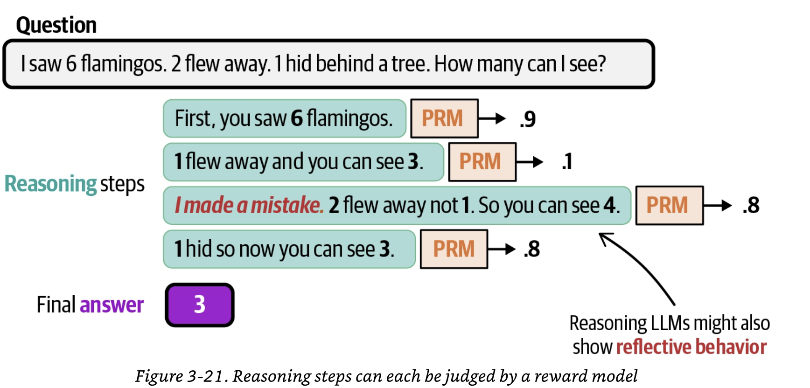

### Prompt Engineering

We saw previously that non-reasoning LLMs were assumed to be able to output reasoning traces (thoughts). How are these non-reasoning LLMs able to output reasoning traces?

Prompt engineering plays a vital role in this process, with a technique called **Chain of Thought (CoT)**. This is one of the first techniques to elicit reasoning in LLMs that were not trained for reasoning tasks.

```python
llm = LLM(model="gemma3.12b",temperature=1)
#Prompts
prompt_example = "I saw 6 flamingos. 2 few away. 1 hid behind the tree. How many can I see?"
prompt_answer = "You saw 6 flamingos. 2 flew away. 6 - 2 = 4. Then, 1 flamingo hid. You see now 4 - 1 = 3."
query = "I saw 9 penguins. 2 slid in the water and disappeared from sight while 4 waddled up from the shore. How many can I see?"
#Messages
messages = [{"role":"user","content":prompt_example},{"role":"assistant","content":prompt_answer},{"role":"user","content":query}]
#Generate responses
response = llm.generate(messages)
print(response)
```
This gives us the right answer by giving the model a couple of examples on how to reason, it follows that behavior and allows for a reasoning process.
This process cab be further simplified by foregoing any examples of reasoning steps and simply stating:

```python
#Message with zero-shot CoT prompting
messages = [{"role":"user","content":query+"let's think step by step"}]
```

CoT prompting requires the model to explain its reasoning process by specifying that in the prompt. LLMs are quite adept at following examples. By demonstrating the desired reasoning style, it increases the liekhood that the LLM will replicate it. Such demonstrations in a prompt are referred to as one-shot prompting or few-shot prompting. 
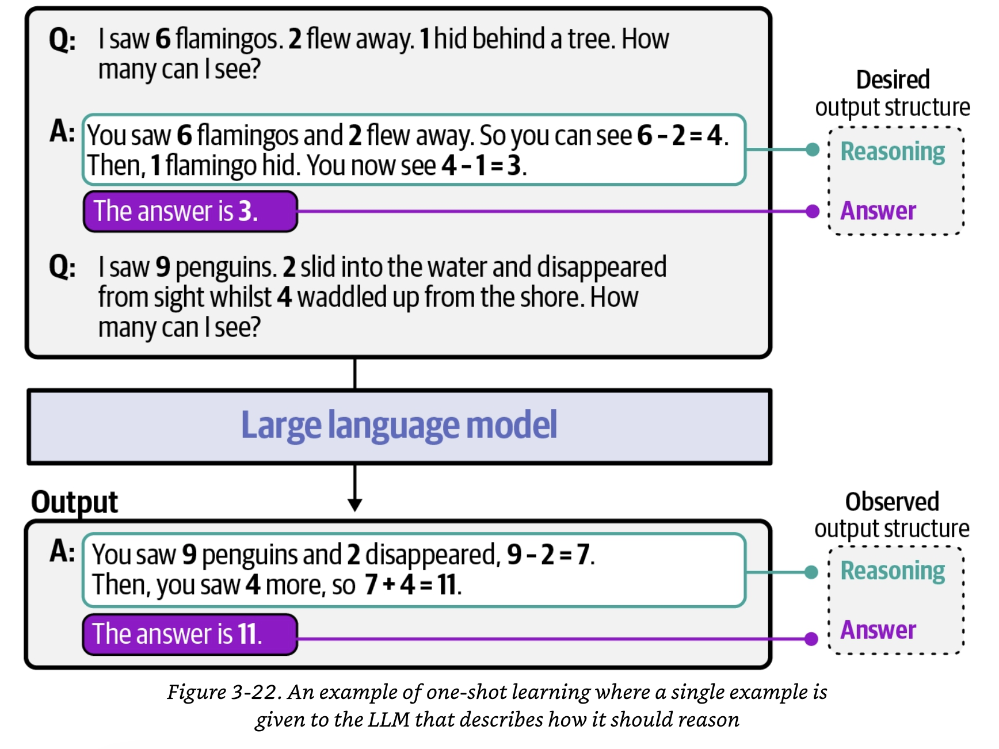

## Search against Verifiers

Search against verifiers refers to a family of techniques that involve generating multiple candidates answers or resoning traces and then evaluating them to choose the best answer.

The scorer is typically referred to as the **reward model (RM)**, also called **verifier**.

Search against verifiers typically consists of three steps.

1. Sampling multiple resoning processes and/or answers
2. A reward model (verifier) scores the generated output
3. The best answer based on the generated scores is chosen

The verifier is typically an LLM, fine-tuned for either judging the outcome (ORM) or the process (PRM). This fine-tuning can be through actual training or by creating a specialized prompt with few-shot examples.

To sample different thoughts and answers to a given question, LLMs can use different temperature values. The temperature parameter in LLMs controls the randomness of the model's output by changing the ditribution of the model's next token probabilities. 
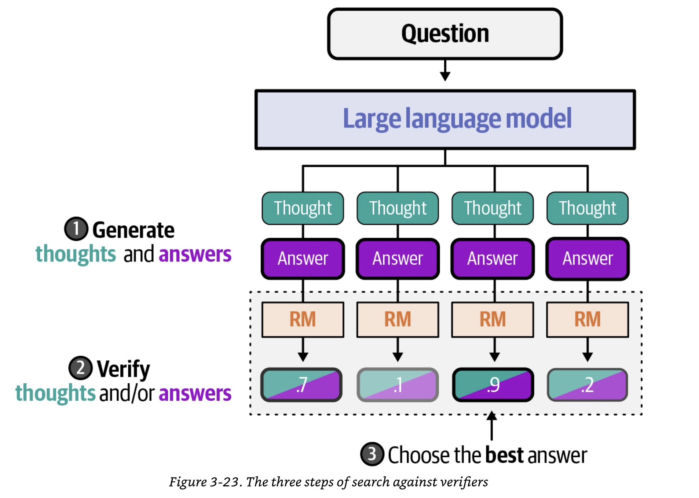

### Self-consistency

One of the first methods for search against verifiers is **self-consistency** and actually does not use a reward model or verifier. Instead, it samples a user-defined number of answers and performs a majority vote to select the most frequent answer.
To generate many different traces and answers, a high temperature is usually combined with CoT-like prompting. 
To see how self-consitency works in practice refers to selfConsistency.py

### Best-of-N Samples

In this method, the LLM generates N candidate answers, typically using a high or varying temperature to encourage diversity. Then, a verifier evaluates each answer and selects the highest-scoring one.

There are 2 main forms of Best-of-N samples, using:

1. Outcome Reward Model (ORM): only the answers are scored using a verifier (e.g. LLM, unit tests, compiler) and the highest scoring answer is chosen.
2. Process Reward Models (PRM): only the processes (thoughts) are scored using verifiers. 

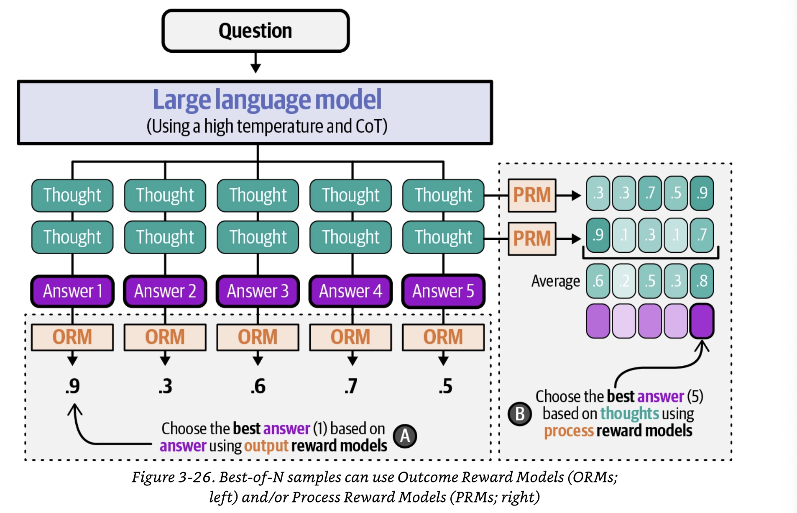

Refer to verify.py

## Modifying Proposal Distibution

In that method, instead of searching for the correct reasoning steps with verifiers (output-focused), the model is trained to demonstrate advanced reasoning steps (input-focused). 
The term "modifying proposal distibution" refers to the distribution from which tokens are sampled. 
A common strategy is to select the token with the highest probability. However, some of the tokens in this distribution are not a direct answer but instead the start of reasoning behavior. If we choose a token that answers the question directly, then it immediately generates a stop token. But, if a token is chosen that is the start of reasoning, then it completes its reasoning until it reaches an answer.
When we modify the proposal distribution, we are essentially making it so that the model re-ranks the distribution such that "reasoning" tokens are selected more frequently.

We can achieve modifying or reranking this ditribution by training the LLM. 2 common methods of training are:
*Supervised fine-tuning (SFT)*
Reasoning behavior is mimicked through supervised fine-tuning, where the LLM is aked to reproduce pre-defined reasoning traces. The model learns to approximate the resoning patterns present in the training data.
*Reinforcement learning (RL)*
The LLM discovers reasoning itself through a reward system.

In other words, supervised fine-tuning stabilizes the model outputs by serving as a memory process to uncover learned behavior, while reinforcement learning enables self-learning and generalization.

### Supervised Fine-Tuning
The model is exposed to triplet-like data, which contains the user's query, a reasoning trace and an answer.
#### s1: Simple test-time scaling
The authors of "1: Simple test-time scaling" demonstrate you could get a reasoning LLM using only small data. They used special tokens to separate the thinking stage from the answering stage. To do so, the thinking stage was enclosed with <|im_start|>think while the following answer was enclosed with <|im_start|>answer.
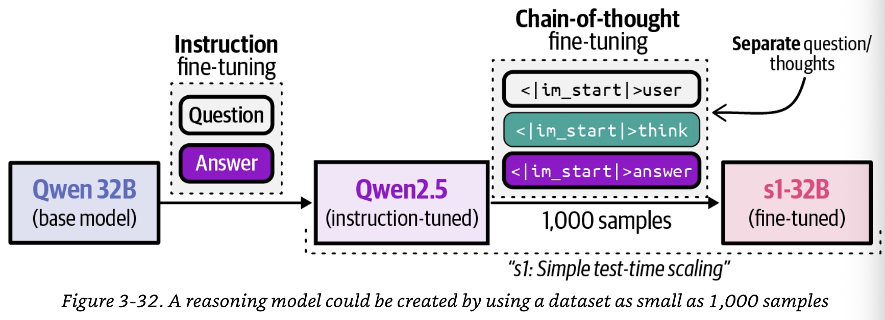 
Additionally, the authors controlled test-time compute in two ways:
1. Forcefully terminating the model's thinking process
2. Lengthening the thinking process by spending "wait" multiple times to the generation when it tries to end.

### Reinforcement Learning

#### Reasoning eith DeepSeek-R1-Zero
In their training procedure, the authors used a custom system prompt that outlined how the LLM should respond. To do so, the thinking stage was enclosed with `<think>` and `</think>` while the following answer was enclosed with `<answer>`and `</answer>`. 
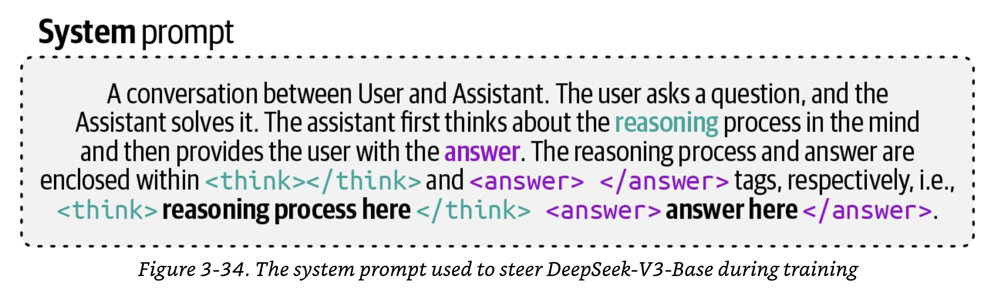

DeepSeek used the same two rule-based rewards from chapter 2: an accuracy reward for arriving at the correct answer, and a format reward for using the `<think>`and `<answer>`tags.
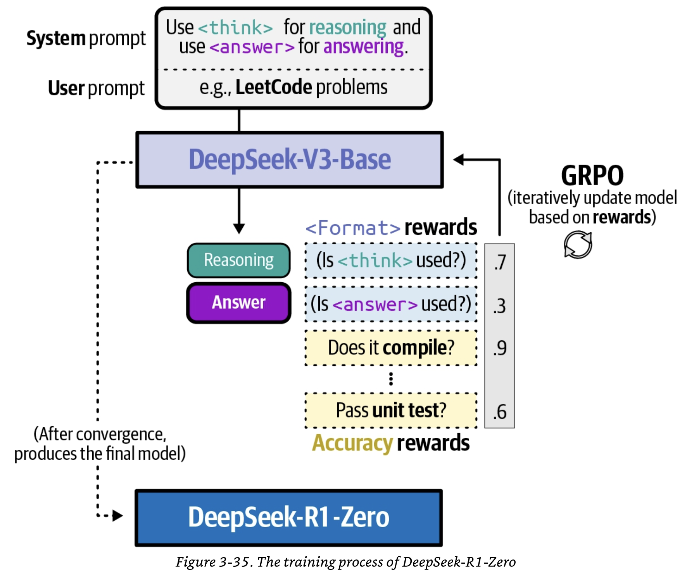

#### DeepSeek-R1

The authors came up with the following five training steps to create DeepSeek-R1:
1. Cold start prevention
2. Reasoning oriented reinforcement learning
3. Rejection sampling
4. Supervised fine-tuning
5. Reinforcement learning for all scenarios

In step 1, to prevent the cold start problem, DeepSeek-V3-Base was fine-tuned with a small but high quality reasoning dataset containing about 5,000 samples with long Chain-of-Thought traces. We call the resulting model DeepSeek-V3-1.
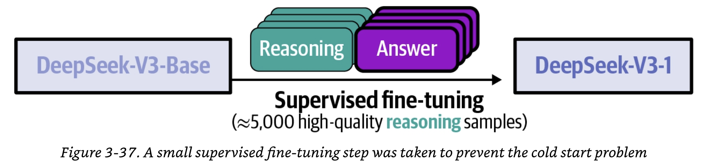

In step 2, DeepSeek-V3-1 was further fine-tuned using GRPO. To further prevent mixing languages in the reasoning traces, a reward was added to ensure the target language remains consistent. The resulting model (DeepSeek-V3-2) is a model trained purely for reasoning. 
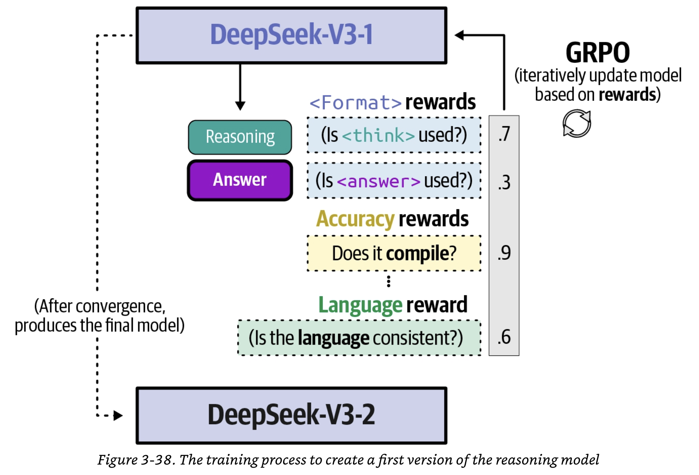

In step 3, the reasoning DeepSeek-V3-2 model was used to generate synthetic reasoning data because it excelled at reasoning tasks. A reward model (DeepSeek-V3-Base) was used to select the high quality reasoning traces.
To make the model more adept at non-reasoning traces, such as writing and translation, DeepSeek-V3-Base was used to sample mostly non-reasoning data that could be trained on.
The result was 800,000 samples that contained both reasoning and non-reasoning data.
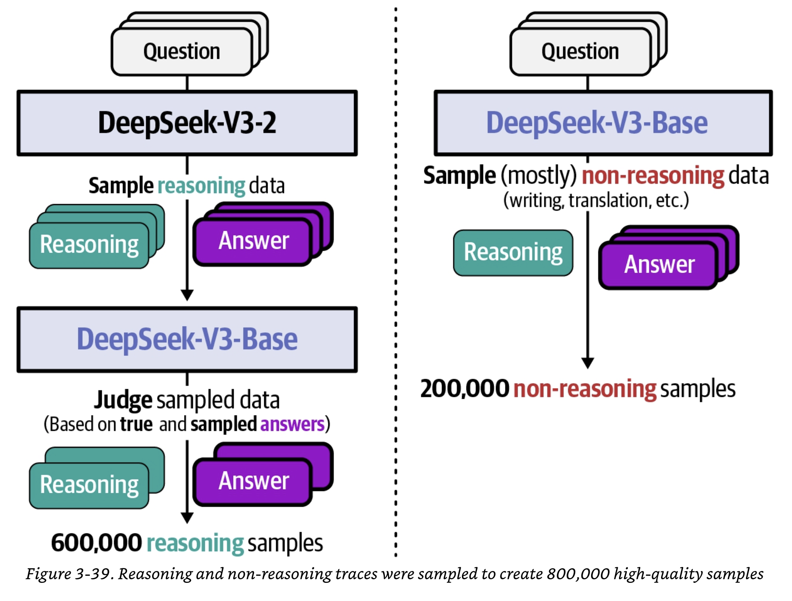

In step 4, this dataset of 800,000 samples was used to perform supervised fine-tuning of the DeepSeekV3-Base model. The resulting model was the first version of DeepSeek-R1.

Finally in step 5, reinforcement learning was done on the first version of DeepSeek-R1 so it could develop its own reasoning traces instead of mimicking them from the data. 
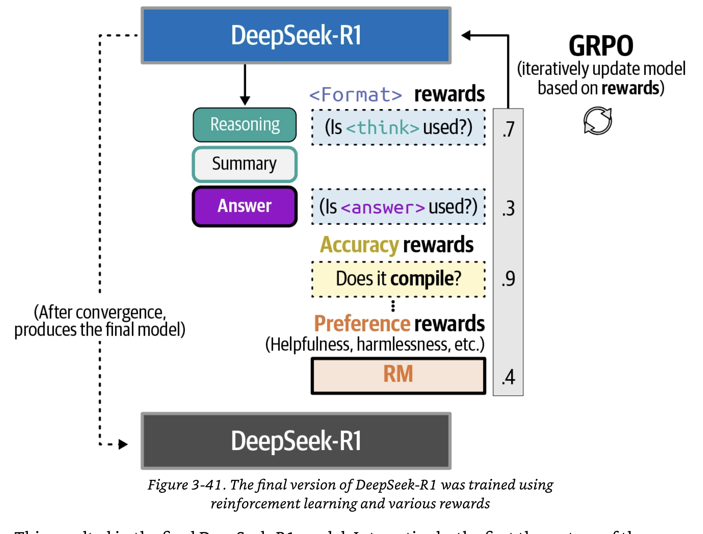

### Native Resoning

How do you use reasoning when the model has learned to reason? This is done via the **chat template**.
The Gemma 4E4B model use in its chat template, among others, the following special tokens:
```
- <bos>: Signals the beginning of the sequence
- <|turn>system: The start of a system prompt.
- <|turn>user: The start of the user turn.
- <|turn>model: The start of the model turn.
- <turn|>: Signals the end of a turn
- <|think|>: Adding this token in the system turn enables reasoning. 
Removing this token in the system turn disables reasoning.
```

Ollama parses the queries automatically based on this chat template.

Let's see what it would look like if the chat template were not enabled automatically.
The Gemma 4 E4B expects the following chat to differentiate between roles and to enable thinking.
```
<bos><|turn>system
<|think|>
SYSTEM_PROMPT <turn|>
<|turn>user
USER_PROMPT<turn|>
<|turn>model
````
If we want to query the model, then we would need to send the following prompt to the model:
````
<bos><|turn>system
<|think|>
You are a helpful assitant <turn|>
<|turn>user
I saw 6 flamingos. 2 flew away. 1 hid behind a tree.
How many can I see?
<turn|>
<|turn>model
````
The model would then respond using a structure as:
````
<|channel>thought
You started with 6, but 2 flew away, leaving 4 behinf.
Out of those 4, 1 is hiding behind a tree, so you can actually see 3.
<channel|>
You can see 3 flamingos
````
As such, any training and fine-tuning that we saw before can now be enabled by the prompt template of that specific model. 

## Emerging Directions in Reasoning Research

3 key areas:

### Reasoning in Multi-Modal LLMs

The LLMs do not need to reason about text. It may need to think about the best way to design a website or interpret what is happening in a given picture.

### Efficient Reasoning

Typically, this involves reducing the length of the reasoning trace. The most straight forward method to reduce the reasoning length is through prompting. 

**Chain-of-Draft (CoD)** employs a more efficient strategy by drafting concise intermediate thoughts.

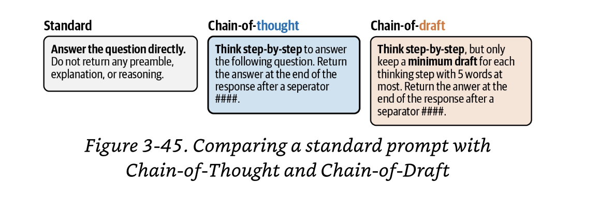

Compared to Chain-of-Thought, Chain-of-Draft generates shorter reasoning traces with less verbosity while having similar performance.
The balance between minimizing verbosity and keeping the accuracy of reasoning traces is difficult to maintain in Chain-of-Draft. 

### Resoning in Latent Space

An upcoming take on reasoning is to make the xplicit Chain-of-Thought of LLMs internal via latent space reasoning. Here, the explicit Chain-of-Thought steps are replaced by hidden representations. 


