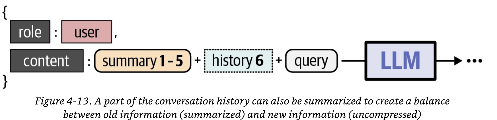
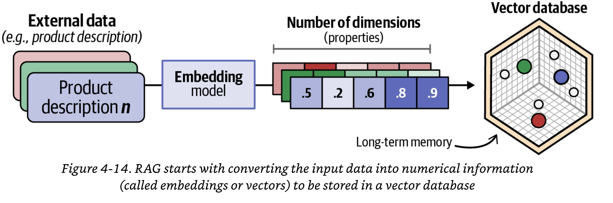
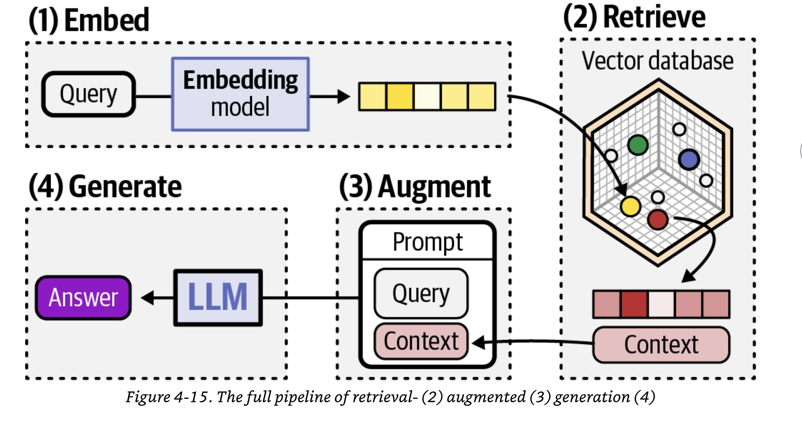
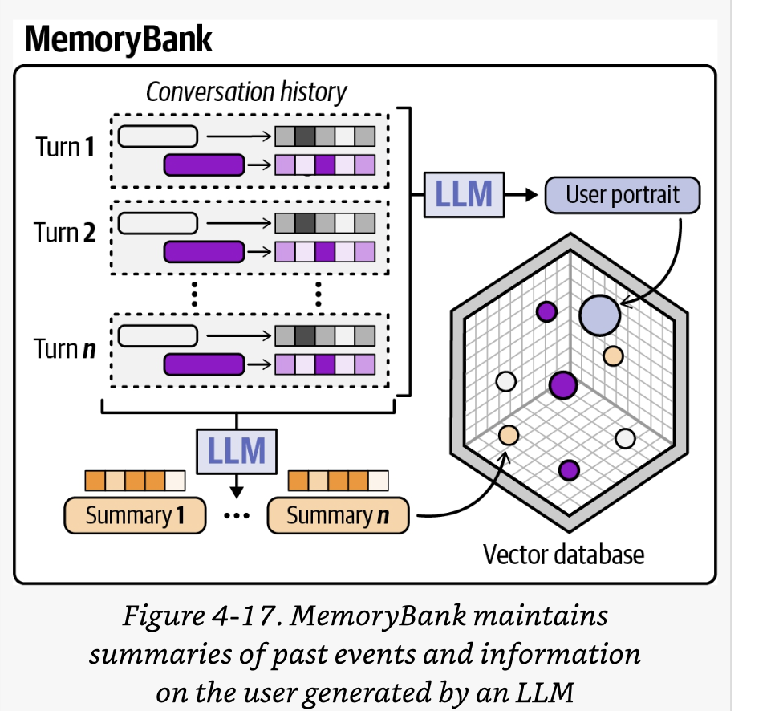
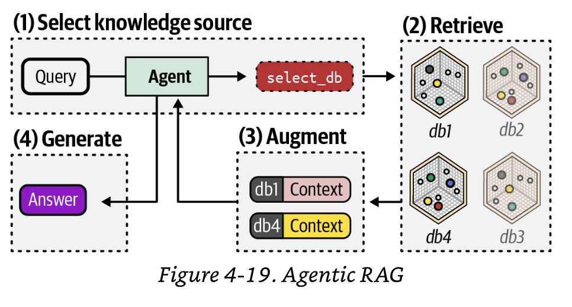
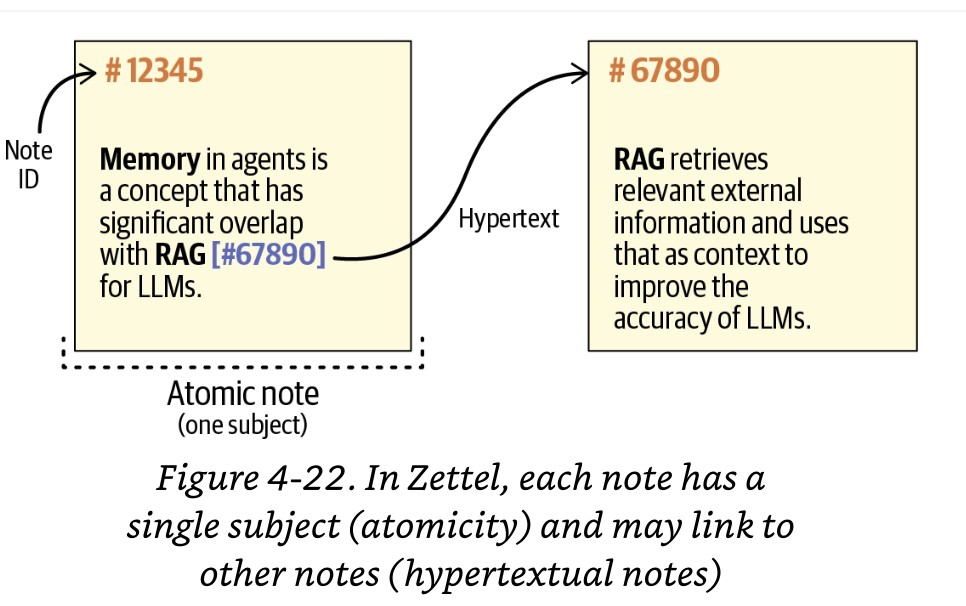
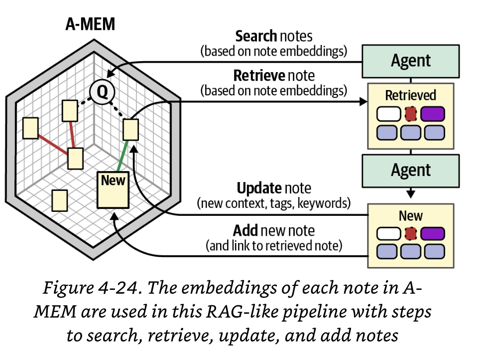
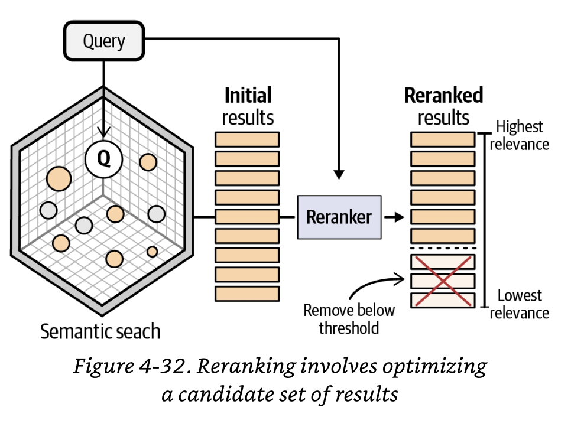

# Memory

By themselves, LLMs are forgetful entities; they do not remember past conversations, nor do they have access to all actions they have taken. 
Without memory, a personal assistant wouldn't be able to remember past conversations. Without memory, a coding agent wouldn't understand your entire codebase. Without memory, an agent would forget that it has already taken an ction and keep repeating it.

Updating and using memory is an iterative process that requires careful handling of intermediate information.

## Types of Memory

We can distinguish 4 type of memory:

- working memory is a type of short-term memory that is typically defined as a system with limited capacity that temporarily holds information that we need for things like decision-making and reasoning. For LLMs, it's typically data that persist across LLM calls. 

Three forms of long-term memory.

- Episodic memory involved remembering specific events and experiences from past. **For agents, these are the specific actions the agent has taken thus far and their outcomes**.

- Semantic memory involves remembering knowledge about the world. For agents, it may involves querying an external database like wikipedia or codebase.

- Procedural memory involves remembering patterns of how to do things. For agents, this can be information hidden in its parameters or the system prompt that persists across calls.

We also consider the type of memory that the model already has, **parametric memory**. 

## Short-Term Memory

Short-term memory in agents is the information it has about recent interactions, typically the ongoing conversations with the user or the behavior of the LLM.

### Conversation Memory

The messages are updated every time the user or assistant replies and are fed back into the LLM as input for the next query. In other words, the LLM does not truly "remember" past conversations but is instead told what the conversation was by explicitly inserting it into the prompt.

```python
from llm import LLM
llm = LLM(model="gemma4:e4b",temperature=1)
from memory import Memory
memory = Memory()
agent_with_memory = TinyAgent(llm=llm, memory=memory)

first_response = agent_with_memory.run("Hi I am Yvan the author of etre Meinhold Werner")

second_response = agent_with_memory.run("What is my name?")

print(second_response)
````
```
You told me your name is **Yvan**.
````
```python
agent_with_memory.memory.get_messages()
````
````
[{'role': 'user', 'content': 'Hi I am Yvan the author of etre Meinhold Werner'}, {'role': 'assitant', 'content': "Hi Yvan, it's nice to meet you! **Être Meinhold Werner** is a very interesting title.\n\nTo help you best, could you tell me a little more about what you'd like to do or discuss regarding your book? For example, are you looking for:\n\n* **Feedback or critique** on the premise, themes, or writing style?\n* **Ideas for promotion** or marketing your book?\n* **Information** about the book (like genre, themes, synopsis)?\n* **Help connecting** with readers or other authors?\n\nLet me know how I can assist you with **Être Meinhold Werner**!"}, {'role': 'user', 'content': 'What is my name?'}, {'role': 'assitant', 'content': 'You told me your name is **Yvan**.'}]
````
Most LLMs have a limited context window, which is the number of tokens that the LLM can process. This counts both the input and the output tokens.

If the conversation history gets too large, it will not fit within the context window. This might cut the answer short or even prevent the LLM fromprocessing the prompt at all.

As a result, we cannot always put the entire conversation history into the prompt of the LLM. Instead, there are several techniques to provide the conversation history without filling up the context window.

#### Trimming

Whenever the number of messages grows too large for the LLM's context window to handle, we can decide to simply remove the first few interactions until it fits that window. This might remove quite a lot of information that may or may not be relevant to future queries.

#### Summarizing

A common technique is to employ another LLM to summarize the conversation history. After each conversation turn, the same or another LLM summarize it and add it to the full summary of the conversation.
This summary might still fill the context window, but it is much slower. Likewise, this can be prevented by summarizing these again but that might compress too much of the original information.
Stacking summaries is not the only method of summarization. Instead of adding a summary of the most recent query/answer pair each time, you can summarize the conversation history of the last five conversations. Likewise, you can maintain one summary and ask the LLM to update it after each conversation.



## Long-term Memory

The usefulness of long-term memory is not limited to conversation history but may also include proprietary ot external knowledge. 
Long-term memory typically involves maintaining one or more external databases that can be queried to extract additional information. This can contain information about previous traces or states of the agent (episodic memory) or information unrelated to agent's behavior about the context of your application instead (semantic memory), like an organization's documents.

### Retrieval-Augmented Generation

The most common method for giving an agent, or any LLM for that matter, long-term memory is **Retrieval-Augmented Generation (RAG)**. 
RAG typically consists of two stages: **ingestion** and **inference**.
In ingestion, the external data, typically unstructured text, is embedded into numerical representations and stored in a database. 
To create these representations, a special variant of an LLM is used, an embedding model, which converts text into numerical vextors (also called **embeddings**) that capture the semantic meaning of the input. This embedding model is trained to create numerical representations such that words and phrases with similar meaning will have similar representations. This external database can be considered the long-term memory of the LLM, which can be queried for relevant information.


Inference with RAG consists in 4 steps. 
In step 1, the user's query is embedded using the same model that was used for embedding the external data.
In step 2, the embedded query is compared to the external database, and the most relevant items in the database to the query is extracted.
In step 3, the relevant items and the user's query are combined into the prompt. This step is meant to provide the model with context for the generation step. Essentially, you tell the LLM that you have contextual information that it can use to derive its answer. 
In step 4, the augmented prompt is used by the model to generate the output. 
RAG is often used to minimize hallucination.


```python
#initialize EmbeddingGemma
from llm import EmbeddingModel
embedding_model = EmbeddingModel(model="embeddinggemma")
output = embedding_model.embed("Dolphins are amazing")
output
[-0.23007706, -0.0032113676, 0.02979069, 0.013562577, -0.049995933, -0.036759768, -0.027315585, 0.03712822, 0.044260487, -0.03380136, -0.03545062, -0.043331932, -0.019636685,...]
```
This model produces 768 values, each between -1 and 1 for a given input.
We can use these values to compare different documents and calculate their similarity. This is typically calculated as the **cosine similarity**. It is calculated through the dot product of the embeddings divided by the product of their lengths for normalization.

```python
#Create embeddings
embedding_a = embedding_model.embed("I love flamingos")
embedding_b = embedding_model.embed("Dolphins use echolocation")
embedding_c = embedding_model.embed("Flamingos are pink birds")

#Calculate cosine similarity between A and B
dot_ab = sum(x*y for x,y in zip(embedding_a,embedding_b))
norm_a = sum(x*x for x in embedding_a)**0.5
norm_b = sum(x*x for x in embedding_b)**0.5
similarity_ab = dot_ab / (norm_a * norm_b)

#Calculate cosine similarity between A and B
dot_ac = sum(x*y for x,y in zip(embedding_a,embedding_c))
norm_c = sum(x*x for x in embedding_c)**0.5
similarity_ac = dot_ac / (norm_a * norm_c)

print(f"Similarity between A and B: {similarity_ab}")
print(f"Similarity between A and C: {similarity_ac}")
```
This gives us as expected a higher similarity between A and C than A and B.
````
Similarity between A and B: 0.41760637331080397
Similarity between A and C: 0.7057046466843958
````
We can use the cosine similarity to perform the comparisons and select the documents that best suit the user's query.
As such, the RAGMemory class performs the following steps:
1. Embed all external documents the agent has no direct access to.
2. Embed user's query.
3. Compare the embeddings and create a similarity matrix.
4. Return the documents with the highest similarity
5. Add those documents to the prompt.

```python
documents = ["Sarah works as a marine biologist studying coral reefs", "Sarah lives in Lisbon, Portugal", "Sarah's favorite hobby is rock climbing", "SaraH's favorite animal is flamingos", "Sarah speaks fluently Spanish and Portuguese", "Ilse is a software engineer at a renewable energy startup", "Ilse lives in Amsterdam, the netherlands", "Ilse plays the cello in a local string band", "Ilse's favorite author is Brandon Sanderson", "Ilse's favorite animal is dolphins"]

from memory import RAGMemory
from llm import EmbeddingModel
from agent import TinyAgent
from llm import LLM

llm = LLM(model="gemma3:12b")
embedding_model = EmbeddingModel(model="embeddinggemma")
memory = RAGMemory(documents=documents, embedding_model=embedding_model)
agent = TinyAgent(llm=llm, memory=memory)

response = agent.run("Have Ilse and Sarah the same favorite animal?")
print(response)

No, Ilse and Sarah do not have the same favorite animal. Ilse likes dolphins, and Sarah likes flamingos.
```
This is what happens under the hood:
```
print(agent.memory.get_messages())

[{'role': 'user', 'content': "Context:\n            Ilse's favorite animal is dolphins\nSaraH's favorite animal is flamingos\nIlse's favorite author is Brandon Sanderson\n            Question:Have Ilse and Sarah the same favorite animal?\n        "}, {'role': 'assitant', 'content': 'No, Ilse and Sarah do not have the same favorite animal. Ilse likes dolphins, and Sarah likes flamingos.'}]
```

Although RAG minimizes the context that you have to pass to the model, there is no guarantee that the context will be good enough. 

### MemoryBank

***MemoryBank** is a mechanism that allows LLMs ti recall relevant memories as a long-term mechanism (external database) rather than short-term mechanism (conversation history).
Its experiences through conversations are stored in a separate database that allows the LLM to retrieve the relevant memories. What sets it apart from regular RAG is that this memory is continuously updated to selectively preserve memory through an updating system.

These forms of memories can be used to create the MemoryBank:
- Conversation history
- Summaries of past events
- User's portrait

When conversation turns are retrieved, their strength is updated, making them less likely to be removed from the MemoryBank.


### Agentic Retrieval-Augmented Generation

In vanilla RAG, the vector database can be considered the long-term memory of the LLM. However, the LLM is only given information that is relevant to the query and has no agency over what is being retrieved.

In agentic RAG, there is an agent instead of an LLM that can access the external database as a tool and have control over which information it retrieves. Agency over what is being retrieved is given back to the agent, who typically has access to one or more external databases of information. 

In single-agent systems, agentic RAG is a router where you have several external knowledge sources, and the agent decides which one(s) you use.
You're essentially adding all these knowledge sources and bases as tools instead of being a static step that runs before the LLM generates output.
In multi-agent RAG systems, multiple agents have the capabilities to extract information from external sources. Oftentimes, you have smaller retrieval agents that are being coordinated by a single agent with more capabilities. These smaller retrieval agents are each specialized in extracting specific information or working with specific knowledge sources.
Note that it does not always have to be a vector database as an external knowledge source; it can also be a web search or an API.

#### A-MEM
An interesting approach to agentic RAG is **A-MEM**, an agentic memory system derived from the note-taking method known as Zettelkasten.
Zettelkasten approaches note-taking as having three imprtant components:
- atomicity: each note contains only one unit of knowledge.
- hypertextual notes: refers to the idea that each note refer to each other and may explain or expand on each other's content.
- personalization

In the context of agents, each note contains the following information and can be considered a piece of memory:
- the original interaction with the environment (i.e., one turn)
- the timestamp of the interaction
- LLM-generated keywords that captur key concepts
- LLM-generated tags to categorize the interaction
- LLM-generated contextual description


#### Search-o1

Instead of autonomously searching for relevant information and using it in the prompt of the model, the information can be searched *during* the LLM's reasoning process. 
The agent is instructed to use ```<|begin_search_query|>``` and ```<|end_search_query|>```tokens to start a search and then use the ```<|begin_search_result|>``` and ```<|end_search_result|>```tokens to indicate what the retrieved information is.

## Context Engineering

To optimize the quality of the output (the output tokens), we can either optimize the LLM itself by training or fine-tuning it, or we can optimize what goes into the LLM, namely, the context.
**Context engineering** is finding the best context such that it maximizes the quality of the LLM's output for a given task. 
With context engineering, we aim to optimize the model's context window with the right information, at the right place, and in the right format. It's the act of giving the LLM the appropriate context without overwhelming it. 
It is largely an architectural problem that needs to be solved with lots of moving parts, like efficiently tracking, storing, and retrieving all existing and created information.

### Context engineering for Multi-agent systems

What makes context engineering especially difficult in multi-agent systems is that not only the context of the main agents needs to be carefully managed, so do the contexts of all other agents in the system. Moreover, the interaction between agents is also part of the shared context between those respective agents.
To manage thos complex network of contexts, smaller agents can be used to handle some of the context. By using a smaller agent with a smaller LLM for specific tasks, part of the context can be handled separately. These smaller / specialized agents can work on smaller and more manageable tasks, have clear responsibilities and are easier to test and debug.

### Optimizing the context

#### Context tracking and storage

Before giving the agent a possible relevant context, it first needs to be tracked and stored somewhere. 

#### Context selection

In RAG, the input documents are typically split into smaller parts, such as sentences or paragraphs, to isolate the information they contain and keep it to a single subject. However, when you run a RAG pipeline, you typically get a collection of documents in return. 
To improve this process, we can use a reranker to refine the set of documents that were retrieved. 


#### Context compression

A common way to handle compression is using an LLM to create summaries. Another method is reducing redundancy. 
A common technique to use for documents, is **Maximal Marginal Relevance (MMR)**. This technique uses a precalculated relevance vector and redundancy matrix to balance diversity of documents.

#### Context ordering

The order of the context is vital to the performance of the agent. Resaerch found that LLMs have a tendency to pay more attention to the beginning and end of a prompt.

### Context as the Specification

The context that you give to the agent, including the query, PLAN.md, REQUIREMENTS.md, codebase, etc., all serve as a tool to communicate your intention. 