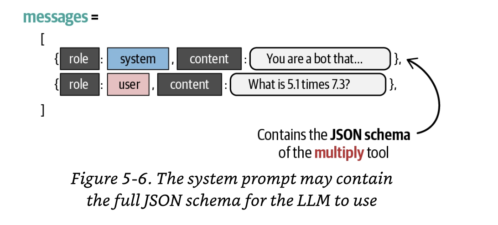
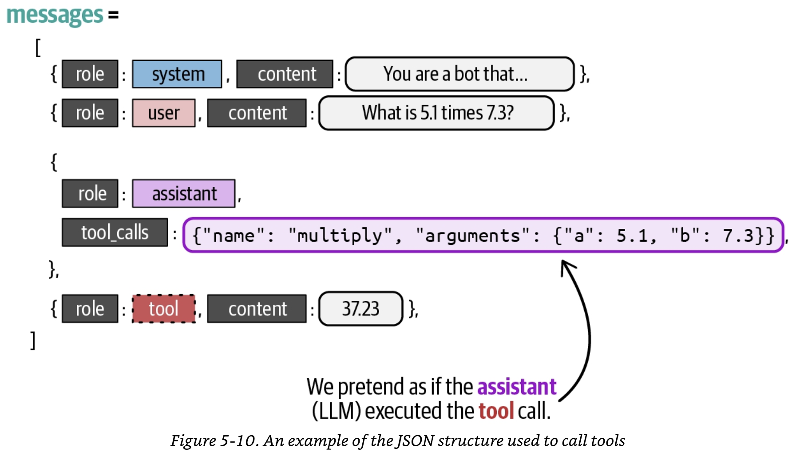
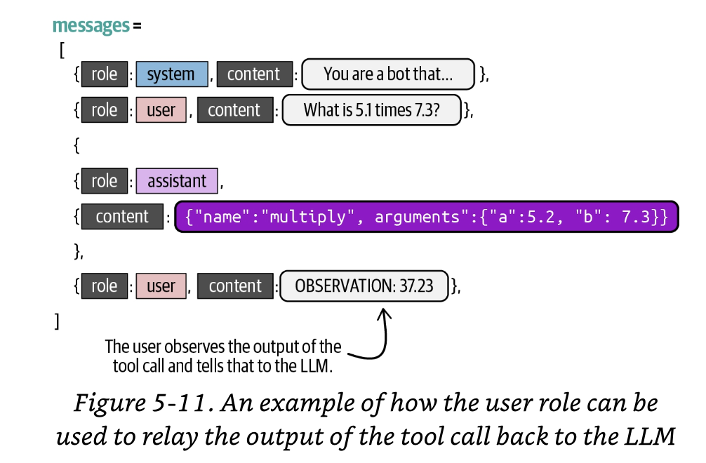
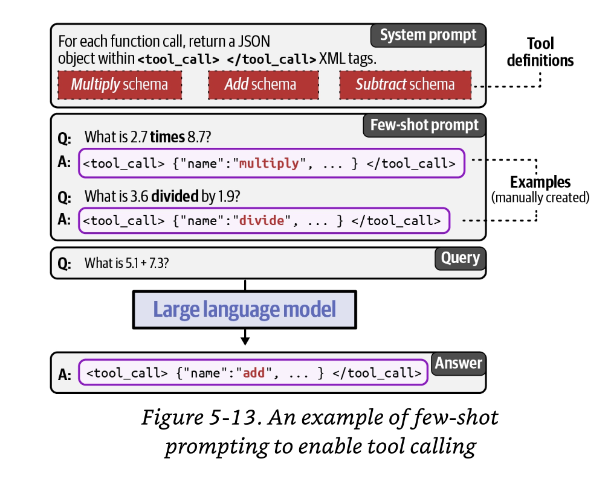
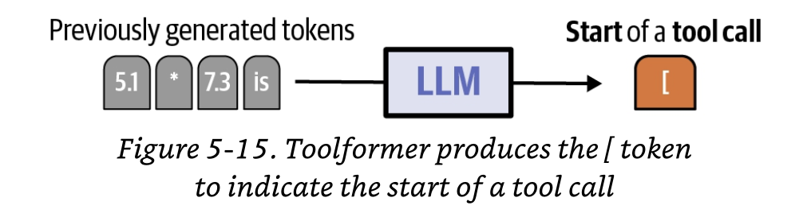
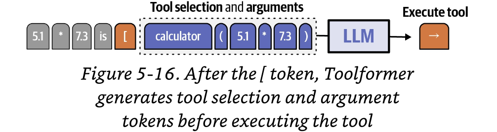
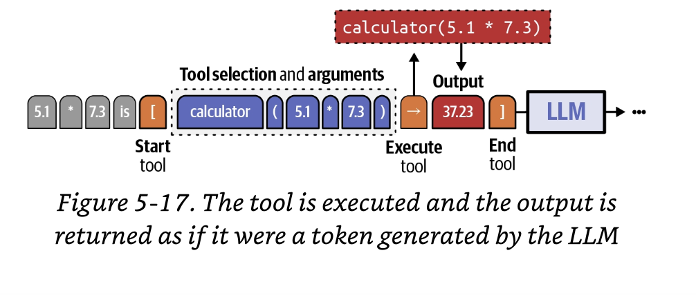

# Tool usage, Learning, and Protocols
Tools, in the form of functions and APIs, allow LLMs to step into the real world and interact with any system exposed to the LLM.
Without tools, agents can only *think and plan* but not *act* autonomously.
The degree of autonomy also decides how tools are used. If there is no autonomy, but there is a fixed flow, then tools can be used in a predefined order. In contrast, systems with larger autonomy allow agents to choose which tools to use and when. 

## Tool Usage

### Tool creation

Although tools come in various forms, they are typically functions that can be accessed through either an API or some internal code. 
Creating tools can be straightforward, but the LLM should be taken into account when designing them.

### Tool Definition

After creating the tool, we need to inform the LLM what the tool does. There are several methods by which we can communicate this to the LLM:
- Learning: (Specific) tool definition and usage are learned during training
- prompting: the tool definition is shared with the LLM through structured prompts

#### Using natural language

As (reasoning) LLMs are becoming easier to steer and dynamically learn to use tools, we can share the tool definitions through prompts. When you have a small set of tools the LLM should use, you can share that through the system prompt:
```python
system_prompt = """
...
#Tool Definition
You can use the following tools:
-multiply(a,b): multiply two numbers
-divide(a,b): divides y by b

#Tool Usage
When you need to use them write:[function_name(value1,value2)]
"""
```
The only thing you need then is a small piece of code that recognizes when a tool is being called. This is called a **validator** or **parser** and requires the LLM to closely follow the usage instructions.
It can therefore be quite error-prone because small errors in following the instructions might result in incomplete calls to the tools.
If we re-register the tool with the prompt:
```python
tools = Tools()
tools.add_tool(
    name="multiply",
    func="multiply",
    description="Multiplies two numbers: multiply(a:str,b:str)"
)
#Show prompt
print(tools.prompt)
```
which gives us:
```python
#Tools
        
        if needed you can only use the following tools to assist you
        in completing tasks:
        multiply:Multiplies two numbers: multiply(a:str,b:str)
        
        To use a tool, respond with JSON:
        {"tool:"name","kwargs":{"param":"value"}}
```
#### Using structured function calling

We can define each tool in structured schemas. These are typically JSON schema objects that include function's name, description, and its parameters(types, required fields, ranges, etc.).
```python
tool_schema = {
    "type":"function",
    "function":{
        "name":"multiply",
        "description":"Multiply two numbers",
        "parameters":{
            "type":"object",
            "properties":{
                "a":{
                    "type":"number",
                    "description":"First number"
                },
                "b":{
                    "type":"number",
                    "description":"Second number"
                }
            },
            "required":[
                "a",
                "b"
            ]
        }
    }
}
```
Although we are using structured JSON schemas for communication, the LLM still has to interpret how to use the tools and when, which makes tool usage a difficult task. 



Best practices for defining functions to take into account:
- Document your tool: extensive descriptions to allow your agent to have a better understanding of what the tool is capable of
- Minimize the number of tools
- Minimize the scope of a tool

### Tool Selection

In tool selection, that is where reasoning LLMs shine. As with context engineering, the process of discovering tools might be helped with methodologies like RAG, where you store all tool in schemas in a separate database for the LLM to discover. 

### Tool calling

When the LLM ends its thinking process, it can start creating the tool call. It will output a string, and if the LLM is capable enough, correctly format the tool call with the given arguments. 

We have to extend the Tools class further with functions that extract and parse the JSON call.
**Note:**
Although regular expressions can be used to extract our tool, they will not work if the tool call has a very slightly different structure or if the JSON structure is more complex. Instead more robust techniques might be needed, such as:
- **jsonschema**, a Python package for validating JSON schemas
- **Pydantic**, a Python package for data validation. It can be used to create data classes where each piece of data can be validated. It allows you to create JSON schemas of your tools to feed the LLM. Likewise the output of the LLM can be converted to JSON and validated through Pydantic.

### Tool Output processing

To feed the output back in the LLM, we can use the messages structure with 2 roles:

- assistant: The assistant calls the tool
- tool: the output of the tool is returned

By updating the messages to include this additional information, we are essentially informing the LLM that these steps were taken. Calling the tool was done outside of the LLM's view, and it therefore has no knowledge of what actually happened. As such, we pretend as if the LLM executed the tool., while that was done by the user or an automated system. 


The specific tool role is used only by LLMs that were trained specifically to perform native tool calling. For LLMs that were not trained with specific tool-calling tokens, the approach is a bit different.
Instead of using the tool role, we can use the user role and act as if we are explicitly telling the LLM what the output of the call was. This is done in the Tools class by adding the functions:
- observation: returns the output of the tool call
- is_done: stops the TinyAgent if there is no tool call or it calls the final_answer tool (chapter 6).


#### The system prompt
In the `__init__`of the TinyAgent, we now add a system prompt. This serves as a nice way for the agent to keep track of what tool it has available. With `self.tools.prompt`, we add the tools' definitions to the system prompt. 

**Note:**
The SummarizationMemory would actually not work well with Tools since it contiunously overrides the system prompt to track the summarized conversation history. Tools requires keeping the tool definition in the system prompt; this would essentially remove any information the LMM has about tools.
A solution would be to always update a section of the system prompt rather than replacing it entirely. 

#### A single step
a single step (`_step`) consists of the following components:
- Generate a response: The LLM generates a response with `self.llm.generate`. You can call this the THOUGHT of the LLM, as it contains what it thinks about the current situation and how it would like to act.
- Tool parsing: If there is a tool call, it is parsed with `self.tools.parse`. This converts the string to a structure JSON output.
- Tool execution: if there is a parsed tool call, it is executed with `_execute_action`
- Stopping mechanism: If there is no tool call, we stop execution entirely. 

#### Executing an action
Executing an action (_execute_action) consists of 2 steps:
- Execute tool call: Executing the JSON tool call with `self.tools.execute(response)`, which performs the tool call.
- track the result: Track the output of the tool call. The LLM has to know what the output is in order to decide what to do next. We do this by adding the output as the user role and describing it with the prefix OBSERVATION.

Finally, we track the state of the agent with the Trajectory module and conversation history with the Memory module.

**Note:** 
The capitalized words: THOUGHT, OBSERVATION, ACTION, and ANSWER are steps relating to the Reason and Act (ReAct) framework that we will use to create autonomous behavior. These mean the following:
- THOUGHT: The reasoning of the LLM on what to do next
- ACTION: The action or tool calls of the LLM are structured as JSON.
- OBSERVATION: The output of the ACTION the LLm took.
- ANSWER: The LLM's final answer after runnig for one or more steps.

#### Running the TinyAgent with tool-calling capabilities

```python
from llm import LLM
from tools import Tools
llm = LLM(model="gemma3:12b")
tools = Tools()
from toolbox import multiply
tools.add_tool(name="multiply",func=multiply,description="Multiplies two numbers:multiply(a:str,b:str)")
from memory import Memory
memory = Memory()
from agent import TinyAgent
agent = TinyAgent(llm=llm,memory=memory,tools=tools)
agent.run("What is 5.1 times 7.3?")

'OBSERVATION:37.23'

print(agent.memory.get_messages())

[{'role': 'system', 'content': 'You are a helpful assistant.\n\n\n        #Tools\n        \n        if needed you can only use the following tools to assist you\n        in completing tasks:\n        multiply:Multiplies two numbers:multiply(a:str,b:str)\n        \n        To use a tool, respond with JSON:\n        {"tool:"name","kwargs":{"param":"value"}}\n        '}, {'role': 'user', 'content': 'What is 5.1 times 7.3?'}, {'role': 'assistant', 'content': '{"tool":"multiply","kwargs":{"a":"5.1","b":"7.3"}}'}, {'role': 'user', 'content': 'OBSERVATION:37.23'}]

```
## Tool Learning

### In-Context learning

In-Context learning, the ability of LLMs to learn from a few examples in their context, is an exceptionally useful technique to enable new behavior in LLMs without the need to fine-tune them. It is also known as **few-shot prompting** or **few-shot learning**, where you provide several examples to the LLM to learn from. 
Specifically, it's a prompt engineering technique where you give some examples of the behavior that you want the LLM to repeat.
  
Since LLMs are great at pattern recognition, providing these example tool calls helps them follow the structure of the tool call we had in mind.

### Supervised Fine-tuning

A great alternative to in context learning is to train the model using supervised fine tuning (SFT) to distill knowledge and capabilities on tool calling into the model itself. 
An interesting technique to explore SFT for tool calling is **Toolformer**, a model trained to decide which APIs to call and how.
Toolformer embeds the call and its output in the text it is generating. It does so by using the [ and ] tokens to indicate the start and end of calling a tool. 
When given a prompt "What is 5.1 times 7.3?", it starts generating tokens until it reaches the [ token:

The [ token tells the LLM that it should start selecting the tool and generate the appropriate parameters following a fixed format. It does it until it reaches the -> token.

The -> token tells the LLM that it can now completely stop generating tokens if a user of an automated system executes the selected tool. The output of the tool is added to the previously generated tokens, along with the ] token.

the token ] tells the LLM that the tool has been executed and the tool call, along with the output, is now part of the previously generated tokens. 
